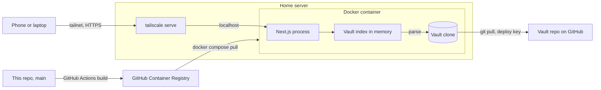

# Architecture

This file records how the job search app is built and why. The feature spec in
[`features/`](features/README.md) says what the app does. Each decision here was agreed on
14 Nov 2026.

The file covers version one, the app that only reads the vault. The last section lists the later
steps and what each one changes.

## The short version

The app is one Next.js process in a Docker container on a home server. The container holds a git
clone of the vault. The app parses the whole clone into an index in memory, and every page reads
from that index. Tailscale is the only way in.



## Decisions

### Next.js with TypeScript

Almost every page is a markdown note turned into HTML on the server. A server component reads the
note from the index and renders it, so the app needs no separate API and stays one codebase.

The links feature decided the language. Wikilinks, links that land on one achievement, missing
targets and "what points to this note" all need the app to walk a parsed note and rewrite each
link. The remark and unified libraries do that, and nothing in Python or .NET does it as well.

The later steps fit the same stack: `better-sqlite3` for SQLite, a child process or the TypeScript
Agent SDK for scans, and server actions for editing.

FastAPI with HTMX was the runner-up. It is less code, but the link handling would be hand-written
and the board filters and phone layouts get awkward without a component library.

### One index of the vault, held in memory

When the process starts, and each time the user selects **Refresh**, the app does this:

```text
refresh
  git pull in VAULT_PATH
  if the pull fails
    keep the old index, show the error on the page
  parse every note: frontmatter, body, links
  check each note against the vault's SCHEMA.md rules, collect warnings
  resolve each link to a note or an achievement, or mark it missing
  build the list of notes that point to each note
  swap the new index in as one step
  record the time of the pull
```

The index holds, for each note: its slug, its type, its frontmatter, its parsed body, its outgoing
links, the notes that point to it, and its warnings.

Two criteria in the spec need the whole vault parsed before any one page can render: "see what
points to a note" and "a link to nothing is visible". Parsing per page would repeat that work on
every request. The vault is a few hundred notes plus about 860 listings, so a full parse takes
seconds at most.

Version one has no database. The files are the only source of truth, and a database would be a
second copy to keep in step with them.

What this means for the code:

- The index is a singleton in the Node process. The app must run as one long-lived process, not
  on a serverless host.
- Pages render on each request. Next.js must not cache a page across a refresh.
- A note with a bad field stays in the index with a warning. It never stops the parse.
- The page shows the time of the last pull that worked.

### A read-only deploy key for the vault

The server holds an SSH key. The vault repo lists the public half as a deploy key with no write
access. The app knows one setting, `VAULT_PATH`, and runs `git pull` in that folder.

The app code never sees a credential, so no secret can reach this public repo. The key reads one
repo and does not expire. A personal access token in an env file was the alternative. It expires,
and the app would have to handle it.

### A Docker container

The image holds Node, the built app and git. Docker Compose on the server gives the container:

| Mount or setting | Purpose |
|---|---|
| A volume at `VAULT_PATH` | The vault clone. It outlives the container. |
| The deploy key, read-only | Lets `git pull` reach the vault repo. |
| A port published on `127.0.0.1` only | Keeps the app off the home network. |

`tailscale serve` on the host forwards the tailnet HTTPS address to that port. Only devices on the
tailnet can open the app, which is how the app meets "other devices cannot open the app" with no
sign-in.

A plain systemd service was the alternative, and it would make the scan step simpler, because
Claude Code would run as the server's user with its login in place. With Docker, that step has to
mount Claude Code's login and config into the container.

### GitHub builds the image

A GitHub Actions workflow runs on each merge to `main`. It builds the image and pushes it to the
GitHub Container Registry. On the server, `docker compose pull && docker compose up -d` starts the
new version. The update is a command run by hand for now.

The repo is public, so the build and the registry cost nothing. A broken build fails in GitHub and
not on the server, and the server needs no Node toolchain. The image is public and holds only app
code. The vault and the key live in the mounts.

### Tailwind CSS with shadcn/ui

shadcn/ui copies its components into the repo as plain files, so the menu, tabs, tables, badges
and filter controls are code that this repo owns. Radix, which the components are built on,
handles keyboard use and focus. Tailwind's breakpoint classes keep the phone rules short, such as
stacking the requirements table into cards on a narrow screen.

Mantine and MUI were the alternative. They bring more ready-made parts, a look that is harder to
change and a bigger bundle.

### The resume is the committed PDF

The vault commits a `resume.pdf` next to each tailored resume. The app serves that file as it is
and never renders a resume. The page draws it with PDF.js, because the built-in viewer on an
iPhone does not show a PDF inside a page. The download button returns the original file.

## What stays out of this repo

The repo is public. It holds no vault content, no personal data and no keys. Tests use made-up
notes that follow the vault's schema. Settings such as `VAULT_PATH` come from the environment on
the server.

## Later steps

Each step gets its own design before work on it starts. This is what is agreed so far.

1. **Run a scan from the app.** Scan data moves from vault files to SQLite on the server. Only the
   scan writes it. A button starts the scan through Claude Code on the server.
2. **Find companies outside the watchlist.** Not designed yet.
3. **Edit from the app.** The posting, the fit analysis and the status move to the database. The
   tailored resume stays a file in the vault, so the server then needs a deploy key with write
   access.
