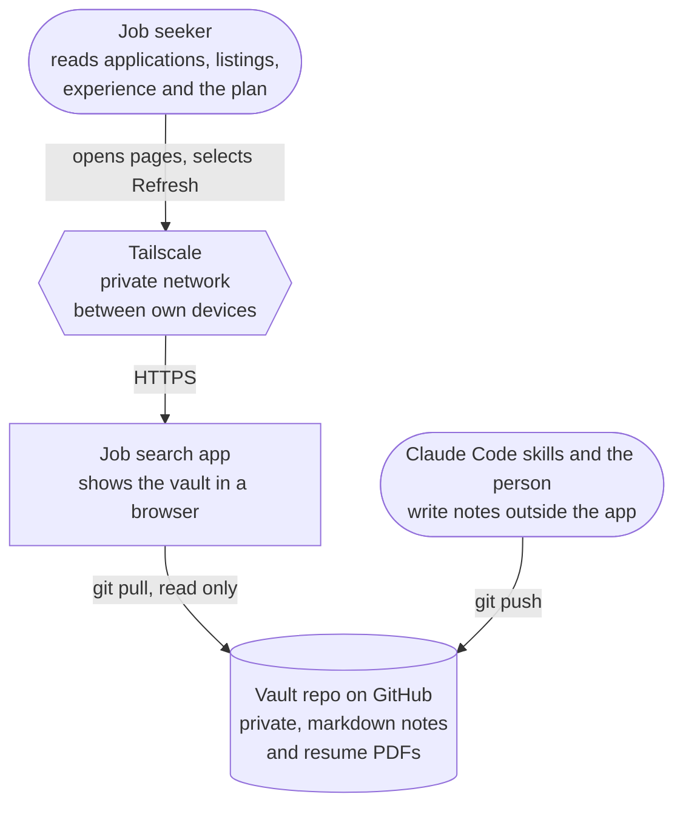
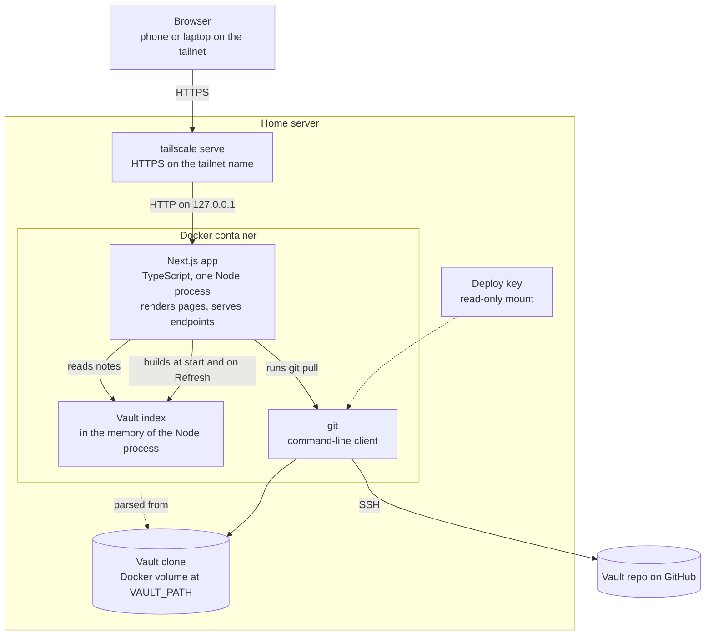
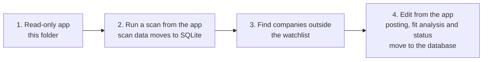

# Architecture

How the job search app is built. This folder covers version one, the app that only reads the
vault. The feature spec is in [`../features/`](../features/README.md) and the reasons for each
choice are in [`../adr/`](../adr/README.md).

| Page | What it shows |
|---|---|
| This page | C4 level 1 and 2: the system and its containers |
| [Components](components.md) | C4 level 3, and what happens on a page load and a Refresh |
| [Deployment](deployment.md) | Where each part runs, and how a release reaches the server |
| [API](api.md) | The backend endpoints |
| [Stack](stack.md) | The frameworks and libraries, each with its job |

The diagrams follow the C4 model. They are Mermaid flowcharts, because GitHub draws those more
clearly than Mermaid's own C4 diagram type.

## Level 1: system context

One person uses the app. The app depends on two outside systems.

## Level 2: containers

| Container | Technology | Job |
|---|---|---|
| Next.js app | Next.js, TypeScript, Node | Renders each page on the server and serves the endpoints in [API](api.md) |
| Vault index | A TypeScript object in memory | Holds every parsed note, its links, its backlinks and its warnings |
| Vault clone | A git working copy on a volume | The server's copy of the vault |
| git | Command-line client in the image | Pulls the vault with the deploy key |
| tailscale serve | Tailscale on the host | Gives the app HTTPS and keeps it private to the tailnet |

## What stays out of this repo

The repo is public. It holds no vault content, no personal data and no keys. Tests use made-up
notes that follow the vault's schema.

## Later steps

Each step gets its own design and its own decision records before work starts.

