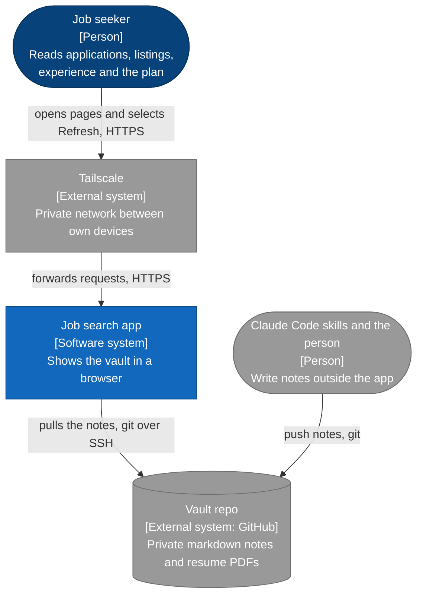
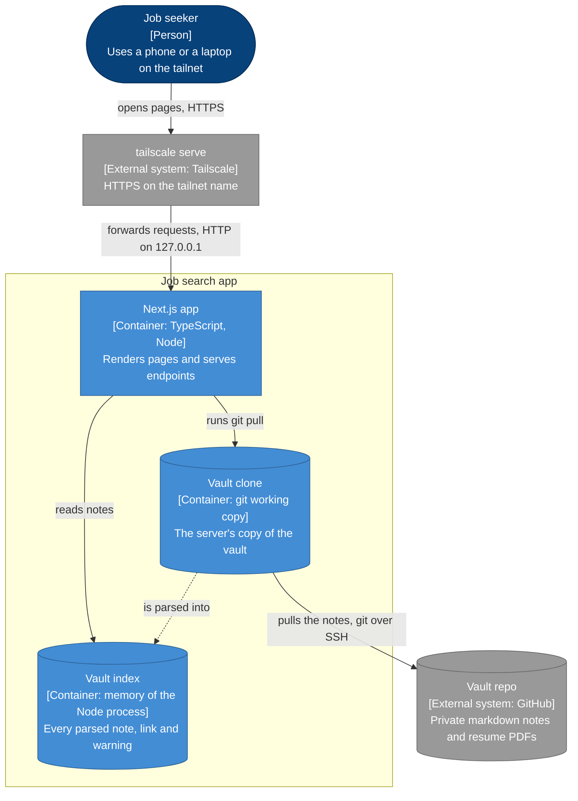

# Architecture

How the job search app is built. This folder covers version one, the app that only reads the
vault. The feature spec is in [`../features/`](../features/README.md) and the reasons for each
choice are in [`../adr/`](../adr/README.md).

| Page | What it shows |
|---|---|
| This page | C4 level 1 and 2: the system and its containers |
| [Components](components.md) | C4 level 3, and what happens on a page load and a Refresh |
| [Deployment](deployment.md) | Where each part runs, and how a release reaches the server |
| [API](api.md) | The backend endpoints |
| [Stack](stack.md) | The frameworks and libraries, each with its job |
| [Diagram templates](diagram-templates.md) | The fixed template for each diagram type |

The diagrams follow the C4 model. Each one starts from a template in
[Diagram templates](diagram-templates.md), so a shape, a colour or an arrow means the same thing
on every page.

## Level 1: system context

Who uses the app, and which outside systems does it depend on?

## Level 2: containers

Which parts that run or hold data make up the app, and how do they talk?

| Container | Technology | Job |
|---|---|---|
| Next.js app | Next.js, TypeScript, Node | Renders each page on the server and serves the endpoints in [API](api.md) |
| Vault index | A TypeScript object in memory | Holds every parsed note, its links, its backlinks and its warnings |
| Vault clone | A git working copy on a volume | The server's copy of the vault, pulled with the deploy key |
| tailscale serve | Tailscale on the host | Gives the app HTTPS and keeps it private to the tailnet |

## What stays out of this repo

The repo is public. It holds no vault content, no personal data and no keys. Tests use made-up
notes that follow the vault's schema.

## Later steps

Each step gets its own design and its own decision records before work starts.

1. The read-only app. This folder.
2. Run a scan from the app. Scan data moves to SQLite.
3. Find companies outside the watchlist.
4. Edit from the app. The posting, the fit analysis and the status move to the database.
