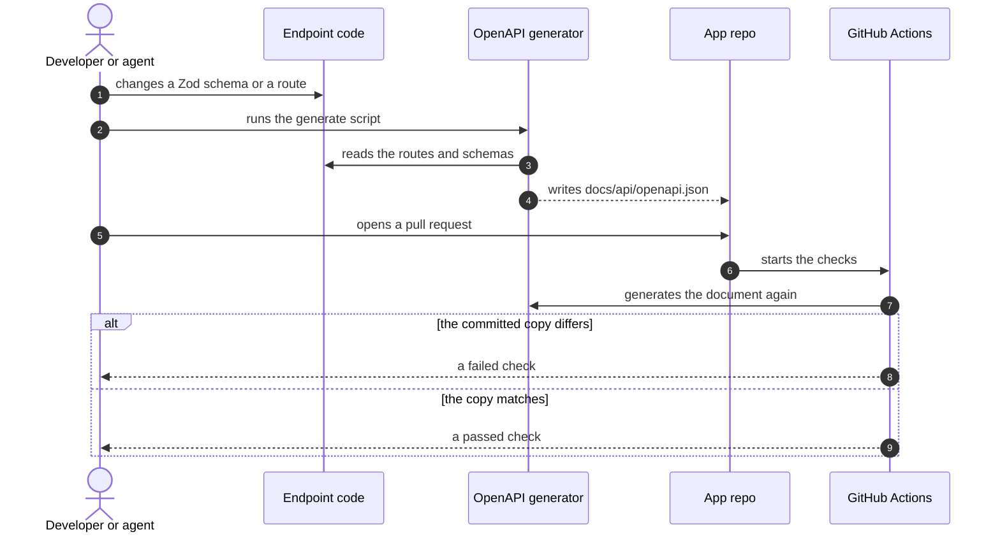

# API

The app has a REST API, and its documentation is generated. This page says how. It does not list
the endpoints, because a hand-written list goes out of date. See
[ADR-0008](../adr/0008-rest-api-with-generated-openapi-docs.md).

## Where to read the API docs

| What | Where | Status |
|---|---|---|
| The docs page, for people | `/api/docs` on the running app | Proposed path |
| The OpenAPI document, for tools and agents | `/api/openapi.json` on the running app | Proposed path |
| A copy of the OpenAPI document in the repo | `docs/api/openapi.json` | Proposed |

The copy in the repo is there so that a person or an agent can read the API without a running
app. A script writes it, and a check on each pull request fails if the copy differs from what the
code generates.

## Sequence: how the API docs are made

How does a change to an endpoint reach the docs?

## Rules for every endpoint

- A Zod schema declares each request and each response.
- The path names a resource with a plural noun, such as `/api/applications/{slug}`.
- A `GET` changes nothing. In version one, only Refresh changes anything, and it is a `POST`.
- An error has one shape for all endpoints: a code, a message, and details when there are any.
- A list that can grow, such as listings, takes filters as query parameters.

## Not decided yet

- Where the API runs: inside the Next.js app, or as its own service.
- The library that builds the OpenAPI document from the Zod schemas.
- How pages call the API.
