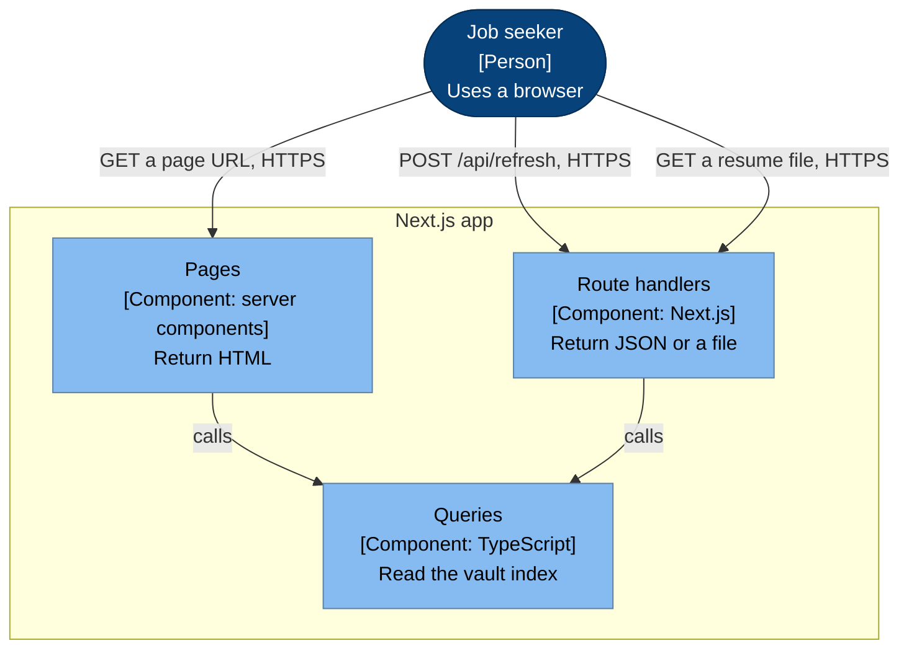

# API

**Status: proposed.** The shape of the backend is an open question. This page shows the design that
follows from [ADR-0001](../adr/0001-nextjs-with-typescript.md): pages read the vault index on the
server, so page data needs no endpoint. The alternative is a REST API for all data, which the
pages call.

## Level 3: how the browser reaches the backend

Which parts of the Next.js app answer the browser?



## Endpoints

| Method | Path | Purpose | Returns |
|---|---|---|---|
| `POST` | `/api/refresh` | Pull the vault and rebuild the index | `200` with the new time and commit, or `502` with the git error and the old time |
| `GET` | `/api/applications/{slug}/resume.pdf` | The committed resume PDF | `200` with the file, or `404` if the application has no resume |
| `GET` | `/api/health` | Tell Docker that the app is up and has an index | `200` with the time of the last update, or `503` before the first index exists |

### `POST /api/refresh`

Request: no body.

```json
{
  "pulledAt": "2026-11-14T07:05:16Z",
  "commit": "a2c0427",
  "notes": 1204,
  "warnings": 3
}
```

On a failed pull:

```json
{
  "error": "git pull failed",
  "detail": "Could not resolve host: github.com",
  "pulledAt": "2026-11-14T06:40:02Z"
}
```

### `GET /api/health`

```json
{ "status": "ok", "pulledAt": "2026-11-14T07:05:16Z" }
```

## Pages

The page URLs are also proposed. Each returns HTML.

| Path | Feature |
|---|---|
| `/` | Application board |
| `/applications/{slug}` | Application page |
| `/shortlist` | Shortlist |
| `/companies/{company}` | Company listings |
| `/companies/{company}/listings/{slug}` | One listing |
| `/experience` | Experience |
| `/experience/{kind}/{slug}` | A role note, project note or story |
| `/search` | Direction and targets |
