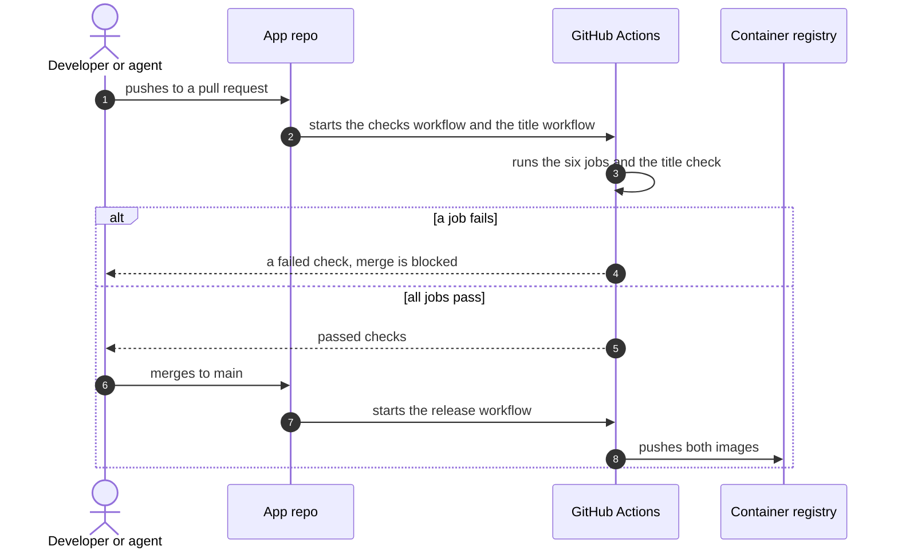

# Pull request checks

What runs on each pull request, and what runs after a merge. Agreed on 14 Nov 2026.

## Sequence: a pull request

What happens between a push and a merge?

## The checks workflow

All six jobs must pass before a merge.

| Job | Command | Catches |
|---|---|---|
| Lint and type check | `pnpm lint` | Style errors and type errors, in both apps |
| Unit and API tests | `pnpm test` | A broken parser, link resolver or endpoint |
| OpenAPI is current | `pnpm openapi`, then a check for changed files | A committed `openapi.json` or Web types that differ from the code |
| Browser tests | `pnpm e2e` | An acceptance criterion that no longer holds, on desktop or phone |
| Image build | `docker compose build` | A Dockerfile that no longer builds. Nothing is pushed. |
| Docs | `pnpm docs:check`, a link check and a Mermaid parse | A dead link between docs, or a diagram that does not draw |

## The title workflow

A squash merge puts the pull request title on `main`. The title workflow fails if the title is not
a Conventional Commit, as `AGENTS.md` describes it. It is a separate workflow because it also runs
when someone edits the title. It runs a shell pattern and installs nothing.

| Job | Checks | Catches |
|---|---|---|
| Pull request title | A type from the list, an optional scope of `web` or `api`, a subject with no period at the end, and 72 characters or fewer | A commit on `main` that does not follow the format |

## Rules on main

- A branch rule requires the checks workflow and the title workflow to pass.
- Nobody pushes to `main` directly.
- The release workflow runs only on `main`, after a merge. It builds and pushes both images.
