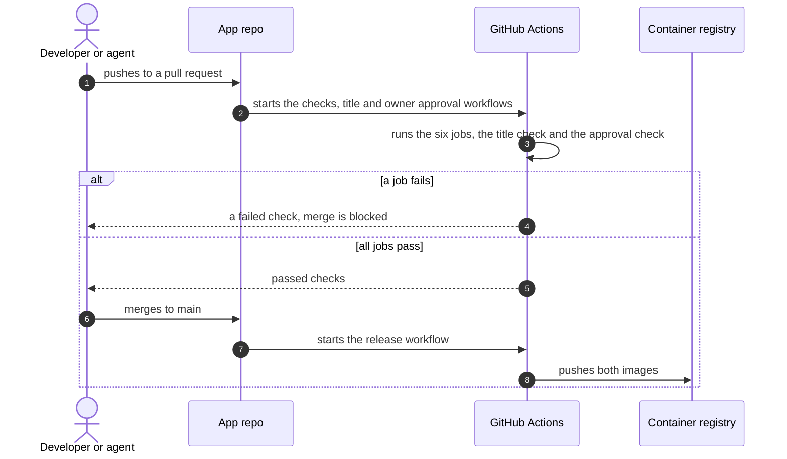

# Pull request checks

What runs on each pull request, and what runs after a merge. Agreed on 14 Nov 2026.

## Sequence: a pull request

What happens between a push and a merge?

## The checks workflow

All six jobs must pass before a merge.

| Job | Command | Catches |
|---|---|---|
| Lint and type check | `pnpm lint` | Style errors and type errors, in both apps |
| Unit and API tests | `pnpm test` | A broken parser, link resolver or endpoint |
| OpenAPI is current | `pnpm openapi`, then a check for changed files | A committed `openapi.json` or Web types that differ from the code |
| Browser tests | `pnpm e2e` | An acceptance criterion that no longer holds, on desktop or phone |
| Image build | `docker compose build` | A Dockerfile that no longer builds. Nothing is pushed. |
| Docs | `pnpm docs:check`, a link check and a Mermaid parse | A dead link between docs, or a diagram that does not draw |

## The title workflow

A squash merge puts the pull request title on `main`. The title workflow fails if the title is not
a Conventional Commit, as `AGENTS.md` describes it. It is a separate workflow because it also runs
when someone edits the title. It runs a shell pattern and installs nothing.

| Job | Checks | Catches |
|---|---|---|
| Pull request title | A type from the list, an optional scope of `web` or `api`, a subject with no period at the end, and 72 characters or fewer | A commit on `main` that does not follow the format |

## The owner approval workflow

The owner approves each change to `docs/adr/` and `docs/features/`.
[Changes](../changes/README.md) has the steps. The owner approval workflow fails a pull request
that changes one of these folders until the owner adds the label `owner-approved`.

| Job | Checks | Catches |
|---|---|---|
| Owner approval | The pull request changes no file in `docs/adr/` or `docs/features/`, or it has the label `owner-approved` and the owner of the repo added the label | An ADR or a change to the feature spec that the owner did not see |

- The workflow runs when a pull request opens, gets a push, or gets or loses a label.
- A push that changes a file in one of the two folders removes the label. The owner adds the
  label again after a look at the new push.
- The workflow uses the `pull_request_target` event, so GitHub runs the copy of the workflow
  that is on `main`. A pull request cannot change the check that judges it. The job reads the
  list of changed files from the GitHub API. It does not check out the code of the pull request.
- Agents open pull requests with the account of the owner, so the workflow cannot tell an agent
  from the owner. The rule in `AGENTS.md` that an agent never adds the label covers that case.

## Rules on main

- A branch rule requires the checks workflow, the title workflow and the owner approval workflow
  to pass.
- Nobody pushes to `main` directly.
- The release workflow runs only on `main`, after a merge. It builds and pushes both images.
