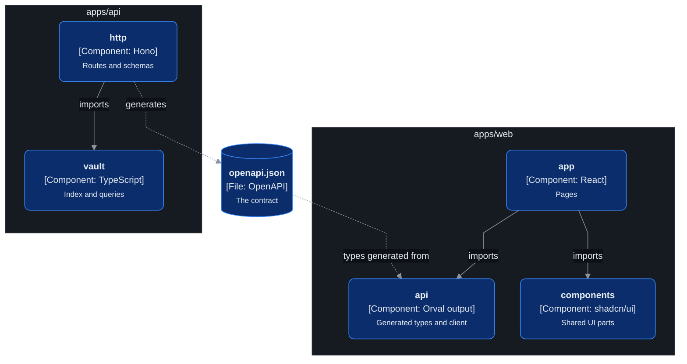

# Code layout

Where each part of the code lives, and which folder may import which. See
[ADR-0010](../adr/0010-monorepo-with-openapi-contract.md).

```text
.
├── apps/
│   ├── web/                 Next.js app
│   │   └── src/
│   │       ├── app/         pages, one folder per route
│   │       ├── components/  shadcn/ui parts, markdown view, PDF view
│   │       └── api/         generated types and the typed client
│   └── api/                 Hono service
│       └── src/
│           ├── http/        routes, Zod schemas, OpenAPI
│           └── vault/       index store, sync, parser, schema check, link resolver, queries
├── fixtures/
│   └── vault/               made-up notes for tests and local runs
├── docs/
│   ├── adr/                 one file per decision
│   ├── api/openapi.json     generated, never edited by hand
│   ├── architecture/        this folder
│   └── features/            the feature spec
└── compose.yaml             both services, for the server and for local runs
```

## Level 3: which folder may import which

Which folder may use which?



## Import rules

- `apps/web` and `apps/api` never import from each other.
- `vault` never imports from `http`. It has no HTTP code and can be tested alone.
- Only `apps/web/src/api` talks to the API. Pages and components go through it.
- Nobody edits `docs/api/openapi.json` or the generated types by hand.
