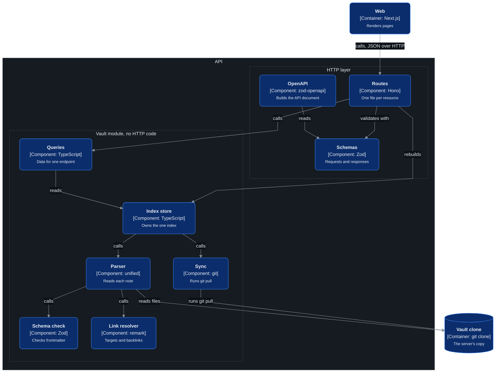
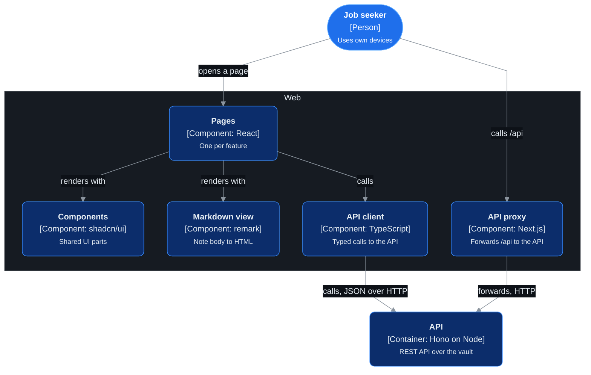
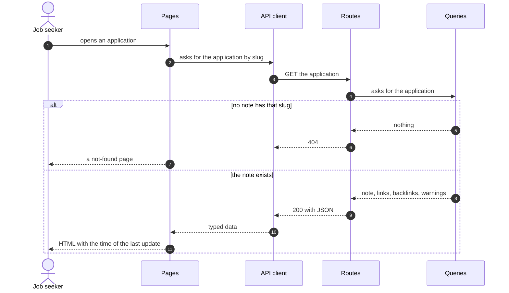
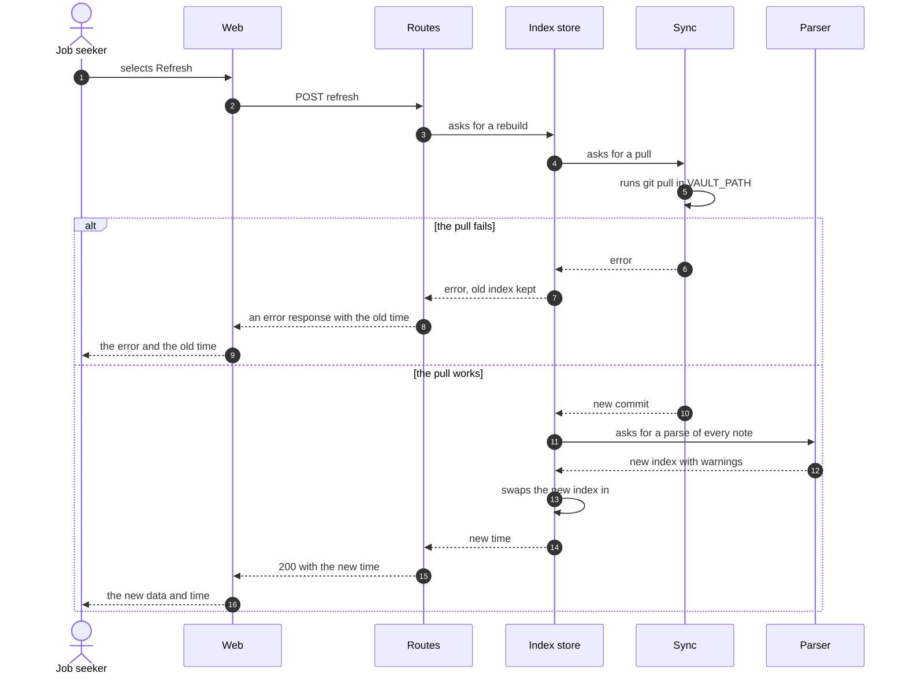

# Components

The parts inside each of the two services.

## Level 3: components of the API

Which parts make up the API, and which part may call which?

| Component | Job |
|---|---|
| Routes | The HTTP endpoints, one file per resource. Holds no vault logic. |
| Schemas | A Zod schema for each request and response. The one source for validation, types and docs. |
| OpenAPI | Builds the OpenAPI document from the routes and the schemas. Serves it with a docs page. |
| Queries | The only way the HTTP layer reads the index. Returns the data for one endpoint. |
| Index store | Owns the one index. Builds a new one and swaps it in as one step. |
| Sync | Runs `git pull` in `VAULT_PATH` and reports the result. |
| Parser | Reads each file into frontmatter and a parsed body. |
| Schema check | Checks frontmatter against the vault's rules and returns warnings. Never throws. |
| Link resolver | Resolves each link to a note or an achievement, marks missing targets, builds backlinks. |

## Level 3: components of Web

Which parts make up Web, and which part may call which?

| Component | Job |
|---|---|
| Pages | One server component per feature in the spec. Gets data through the API client. |
| Components | The shared UI parts from shadcn/ui: menu, board, tables, tabs, filters, PDF view. |
| Markdown view | Turns a note body into HTML. Uses the link table from the API to make each link. |
| API client | Typed functions for each endpoint. Its types are generated from the OpenAPI document. |
| API proxy | Forwards a browser request for `/api/*` to the API, for Refresh, the resume PDF and the docs page. |

## Sequence: a page load

What happens when the person opens a page?

## Sequence: a Refresh

What happens when the person selects Refresh?

## Data: what the index holds

| Thing | Fields |
|---|---|
| Vault index | The time of the pull, the commit, every note, and the path of every file |
| Note | Slug, type, frontmatter, body, warnings, links out, backlinks |
| Link | Target slug, achievement, label, and whether the target is missing |
