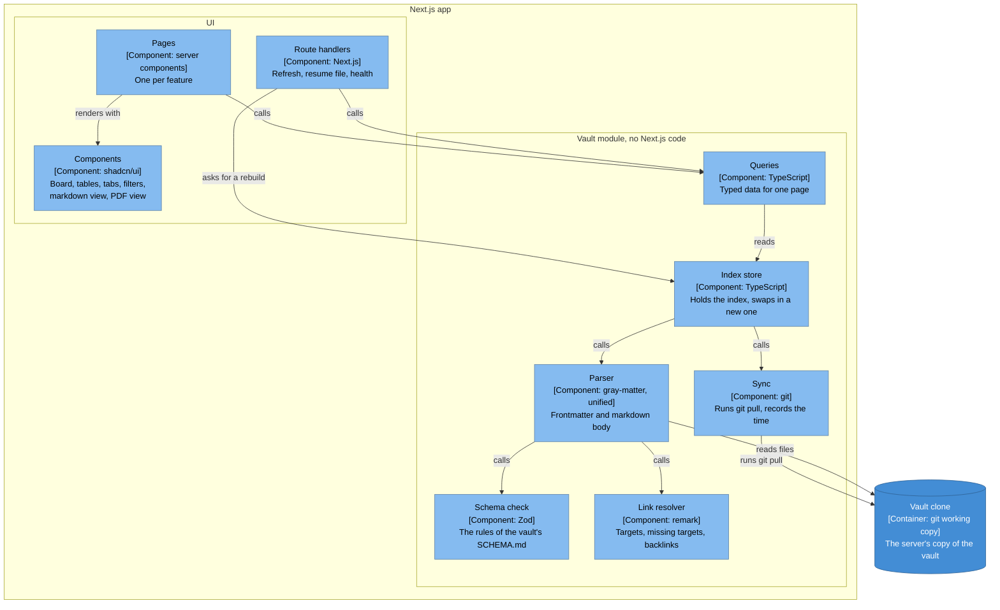
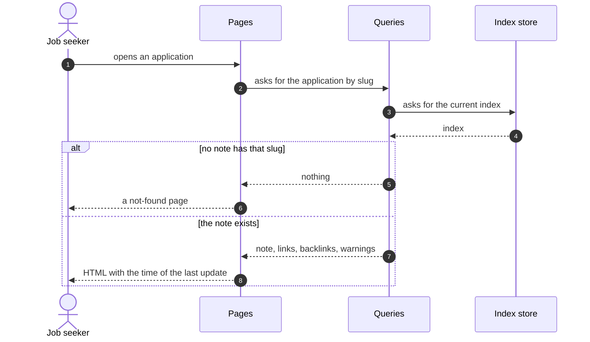
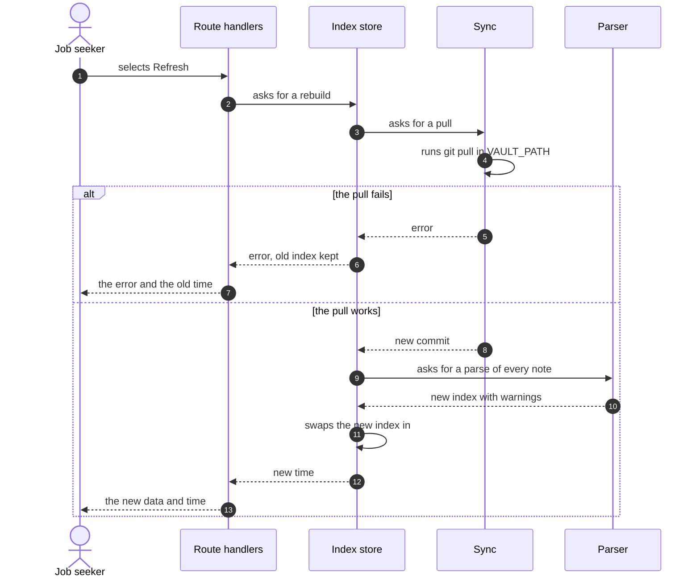
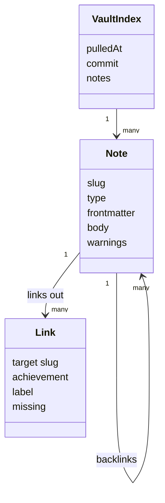

# Components

The parts inside the Next.js app. The split is a proposal until the code layout is agreed.

## Level 3: components of the Next.js app

Which parts make up the Next.js app, and which part may call which?

| Component | Job |
|---|---|
| Pages | One server component per feature in the spec. Reads through Queries and renders HTML. |
| Components | The shared UI parts from shadcn/ui, plus the markdown view and the PDF view. |
| Route handlers | The endpoints that are not pages. See [API](api.md). |
| Queries | The only way the UI reads the index. Returns typed data for one page. |
| Index store | Owns the one index. Builds a new one and swaps it in as one step. |
| Sync | Runs `git pull` in `VAULT_PATH` and reports the result. |
| Parser | Reads each file into frontmatter and a parsed body. |
| Schema check | Checks frontmatter against the vault's rules and returns warnings. Never throws. |
| Link resolver | Resolves each link to a note or an achievement, marks missing targets, builds backlinks. |

## Sequence: a page load

What happens when the person opens a page?

## Sequence: a Refresh

What happens when the person selects Refresh?

## Data: what the index holds

This is a class diagram, which has no template yet. It shows the shape of the index.

