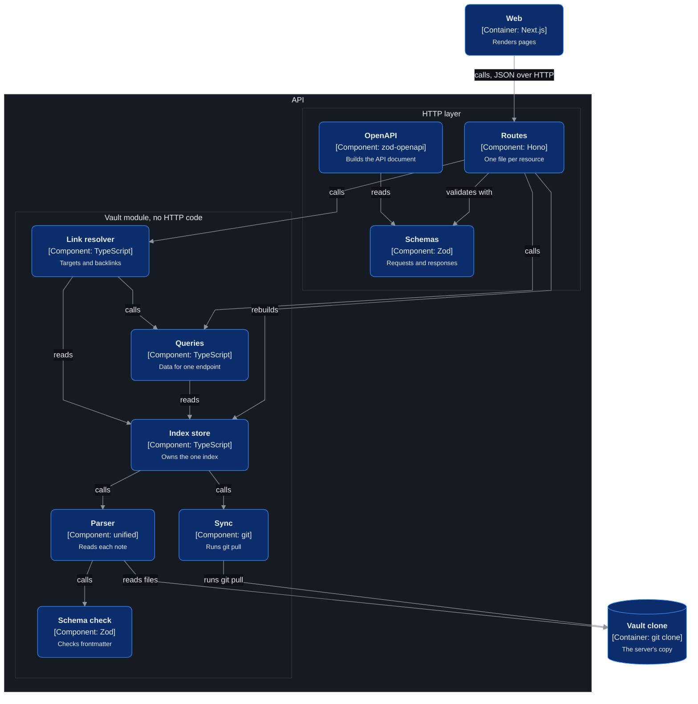
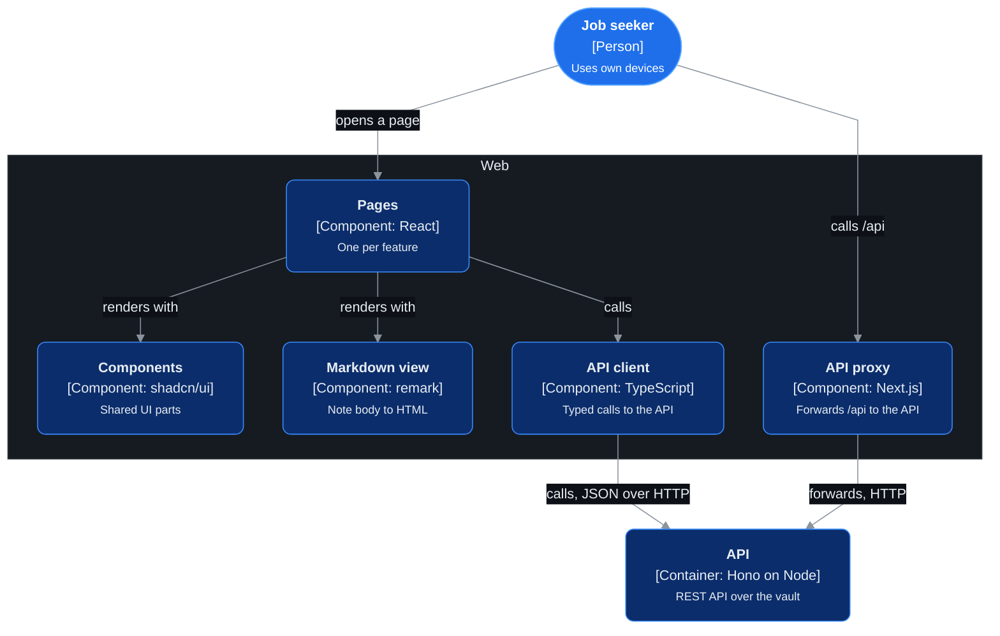
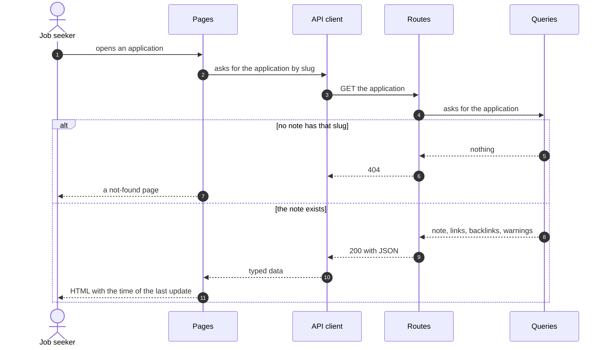
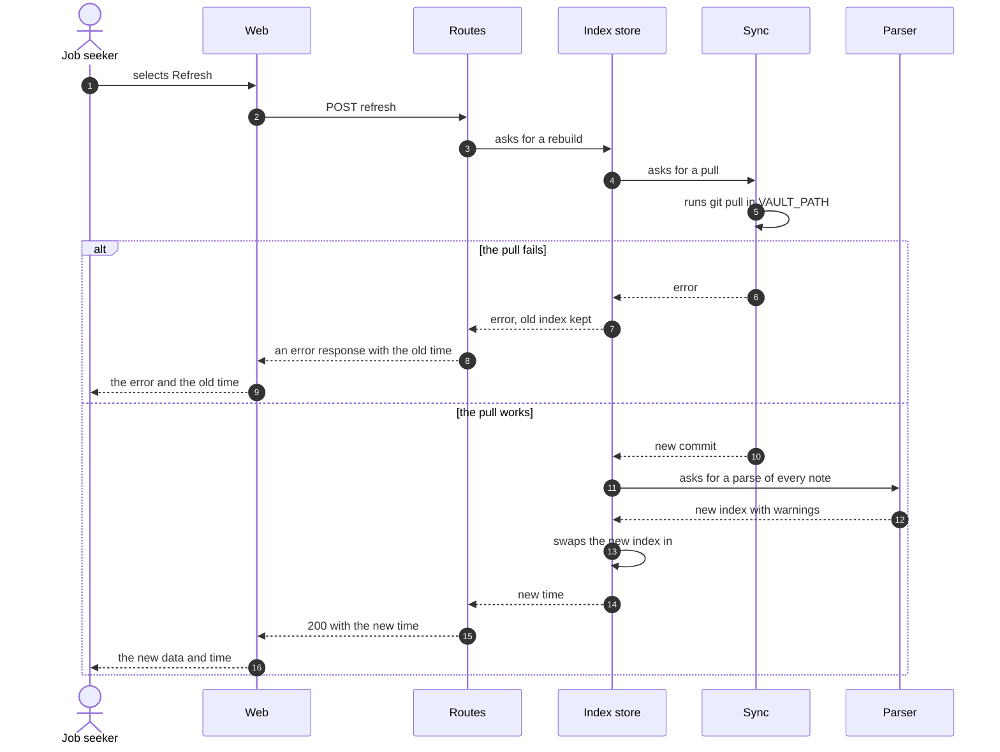

# Components

The parts inside each of the two services.

## Level 3: components of the API

Which parts make up the API, and which part may call which?

| Component | Job |
|---|---|
| Routes | The HTTP endpoints, one file per resource. Holds no vault logic. |
| Schemas | A Zod schema for each request and response. The one source for validation, types and docs. |
| OpenAPI | Builds the OpenAPI document from the routes and the schemas. Serves it with a docs page. |
| Queries | The only way the HTTP layer reads the index. Returns the data for one endpoint. |
| Index store | Owns the one index. Builds a new one and swaps it in as one step. |
| Sync | Runs `git pull` in `VAULT_PATH` and reports the result. |
| Parser | Reads each file into frontmatter and a parsed body, and finds the `[[wikilinks]]` of the body. |
| Schema check | Checks frontmatter against the vault's rules and returns warnings. Never throws. |
| Link resolver | Resolves each link to a note or an achievement, marks missing targets, builds backlinks. |

## How a link resolves

The link resolver is `apps/api/src/vault/links.ts`. A route adds its result to the response of a
page: `links` is the link table of the markdown in the response, and `backlinks` is the list of
the notes that name the note.

The markdown in a response keeps each `[[wikilink]]` as the note writes it. The Markdown view of
Web finds the link in the table by its `ref`, which is the text of the link without the brackets
and the label. A link has one of three states:

| State | Case | What Web shows |
|---|---|---|
| `found` | The target has a page | A link with the label of the writer, or the title of the achievement or the note |
| `missing` | The vault has no such note, or the role note or project note has no such achievement | Text with a mark |
| `no-page` | The note exists, and the app has no page for it: a journal file, the direction, the targets | Text |

The resolver finds the target of a name in this order:

1. A listing with that name in the company of the note that has the link, or in the company that
   the link writes as `company/listing`.
2. A role note, a project note, a story or an application with that name. The name of an
   application is the name of its folder.
3. A listing with that name, if only one company has it.
4. Each other note with that file name.

An anchor names an achievement of a role note or a project note. The link can write the anchor
or the heading. On each other kind of note, the resolver ignores the anchor.

A note names a second note in four ways, and each one makes a backlink:

- a `[[wikilink]]` in its text
- a slug in its facts: `roles` of a story, `programme` of a role note, `source-listing` of an
  application
- a reference to an achievement in the evidence of its fit analysis
- the application column of a company index, which counts as the listing naming the application

Only a note with a page can be in the list of backlinks. The resolver builds the backlinks of the
whole vault on the first request after a load and keeps them with the index.

## Level 3: components of Web

Which parts make up Web, and which part may call which?

| Component | Job |
|---|---|
| Pages | One server component per feature in the spec. Gets data through the API client. |
| Components | The shared UI parts from shadcn/ui: menu, board, tables, tabs, filters, PDF view. |
| Markdown view | Turns a note body into HTML. Uses the link table from the API to make each link. |
| API client | Typed functions for each endpoint. Its types are generated from the OpenAPI document. |
| API proxy | Forwards a browser request for `/api/*` to the API, for Refresh, the resume PDF and the docs page. |

## Sequence: a page load

What happens when the person opens a page?

## Sequence: a Refresh

What happens when the person selects Refresh?

## Data: what the index holds

| Thing | Fields |
|---|---|
| Vault index | The time of the pull, the commit, every note, and the path of every file |
| Note | Path, slug, type, frontmatter, body, links out |
| Link | The name of the target and the anchor, as the note writes them |
| Backlinks | For each note, the notes that name it. Built on the first request after a load |
