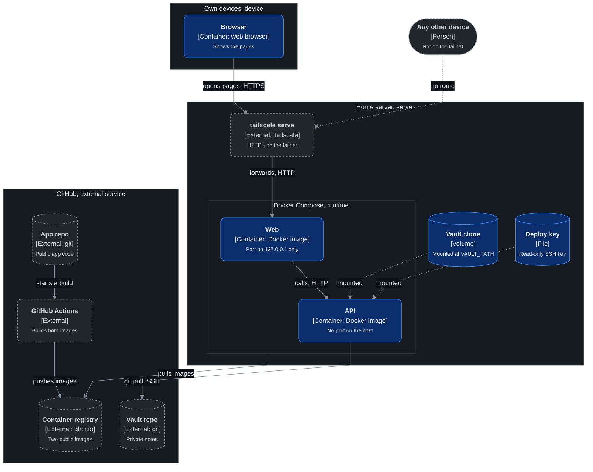
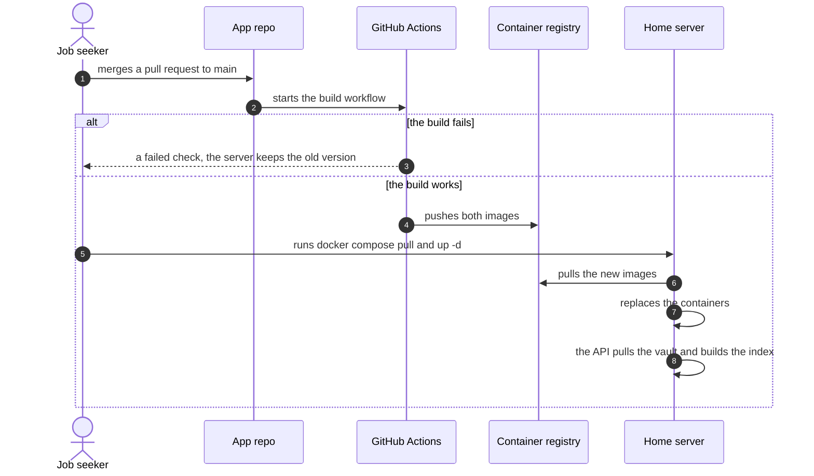

# Deployment

Where each part runs, and how a new version gets there.

## Deployment: version one

On which machine does each part run, and what connects the machines?

| Node | Runs | Holds |
|---|---|---|
| Home server | Docker, Tailscale | Both containers, the vault clone, the deploy key |
| Web container | Node, the built Next.js app | No data. It can be replaced at any time. |
| API container | Node, the built API, git | The vault index in memory. It can be replaced at any time. |
| Volume | | The vault clone. It outlives the containers. |
| GitHub | Actions, the registry | The app code, the two public images, the private vault |

A third container, the trace viewer, runs only with the `tracing` profile and is not in the
diagram. See [Errors, logging and tracing](errors-and-logging.md).

The two containers share a private Docker network. Web calls the API by its service name. The API
has no port on the host and no route from the tailnet except through Web.

## Sequence: a release

What happens when a pull request merges to `main`?

## Settings

| Setting | Where it is set | Purpose |
|---|---|---|
| `VAULT_PATH` | Compose file on the server | The folder of the vault clone inside the API container |
| `API_URL` | Compose file on the server | The address of the API on the Docker network, for Web |
| `OTEL_EXPORTER_OTLP_ENDPOINT` | The `tracing` profile of the Compose file | Where both services send traces. Not set in normal use. |
| Deploy key path | Compose file on the server | The key that `git pull` uses |

No setting holds a secret value. The key is a file on the server and is never in the repo or the
image.

## One-time setup on the server

1. Create an SSH key on the server.
2. Add the public key to the vault repo as a deploy key. Do not give it write access.
3. Clone the vault into the volume.
4. Write the Compose file with the two services, the volume, the key mount and the Web port on
   `127.0.0.1`.
5. Run `tailscale serve` to forward the tailnet HTTPS address to that port.
6. Run `docker compose up -d`.
