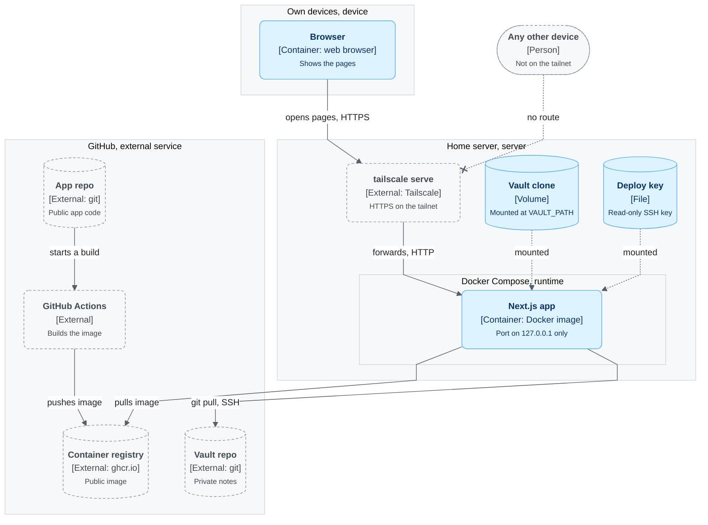
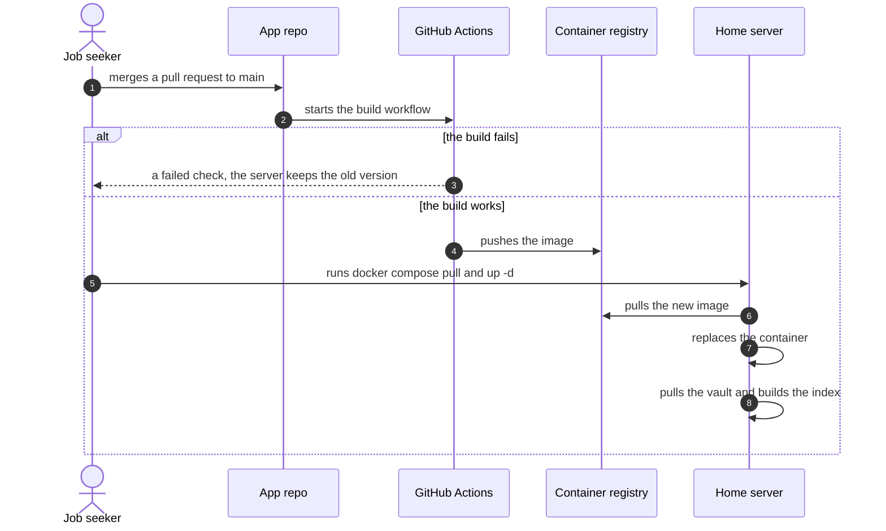

# Deployment

Where each part runs, and how a new version gets there.

## Deployment: version one

On which machine does each part run, and what connects the machines?

| Node | Runs | Holds |
|---|---|---|
| Home server | Docker, Tailscale | The container, the vault clone, the deploy key |
| Container | Node, the built app, git | No data of its own. It can be replaced at any time. |
| Volume | | The vault clone. It outlives the container. |
| GitHub | Actions, the registry | The app code, the public image, the private vault |

## Sequence: a release

What happens when a pull request merges to `main`?

## Settings

| Setting | Where it is set | Purpose |
|---|---|---|
| `VAULT_PATH` | Compose file on the server | The folder of the vault clone inside the container |
| Deploy key path | Compose file on the server | The key that `git pull` uses |

No setting holds a secret value. The key is a file on the server and is never in the repo or the
image.

## One-time setup on the server

1. Create an SSH key on the server.
2. Add the public key to the vault repo as a deploy key. Do not give it write access.
3. Clone the vault into the volume.
4. Write the Compose file with the volume, the key mount and the port on `127.0.0.1`.
5. Run `tailscale serve` to forward the tailnet HTTPS address to that port.
6. Run `docker compose up -d`.
