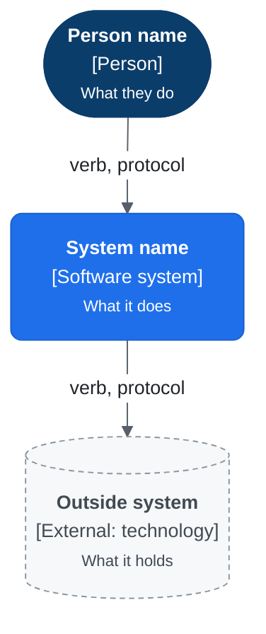
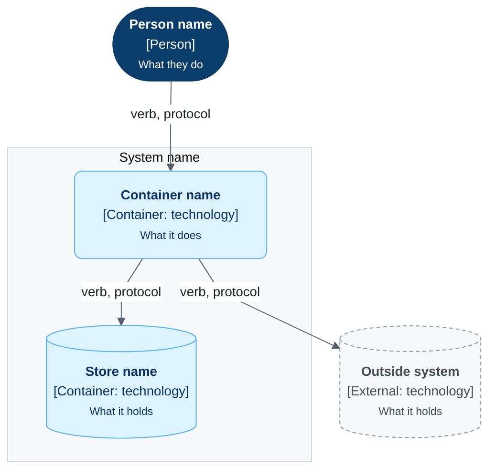
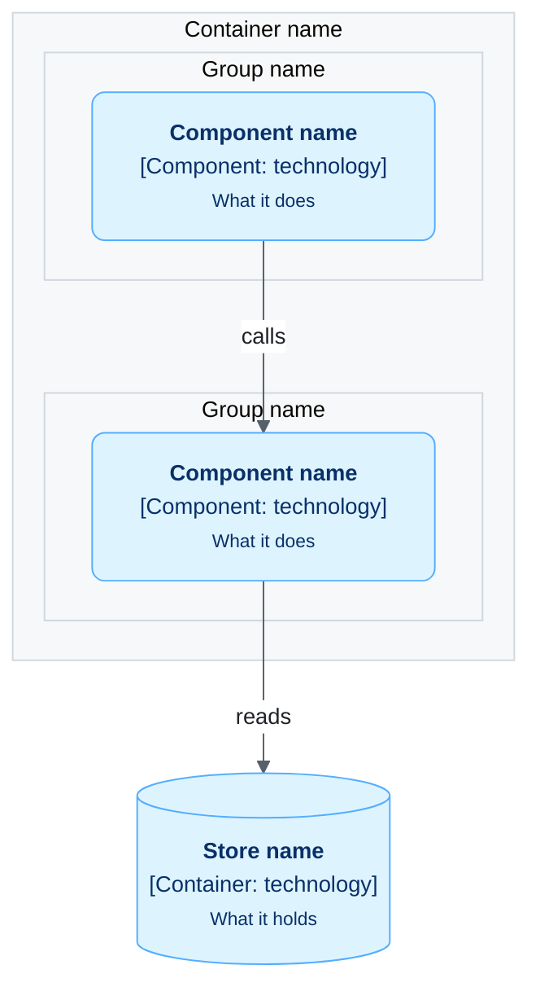
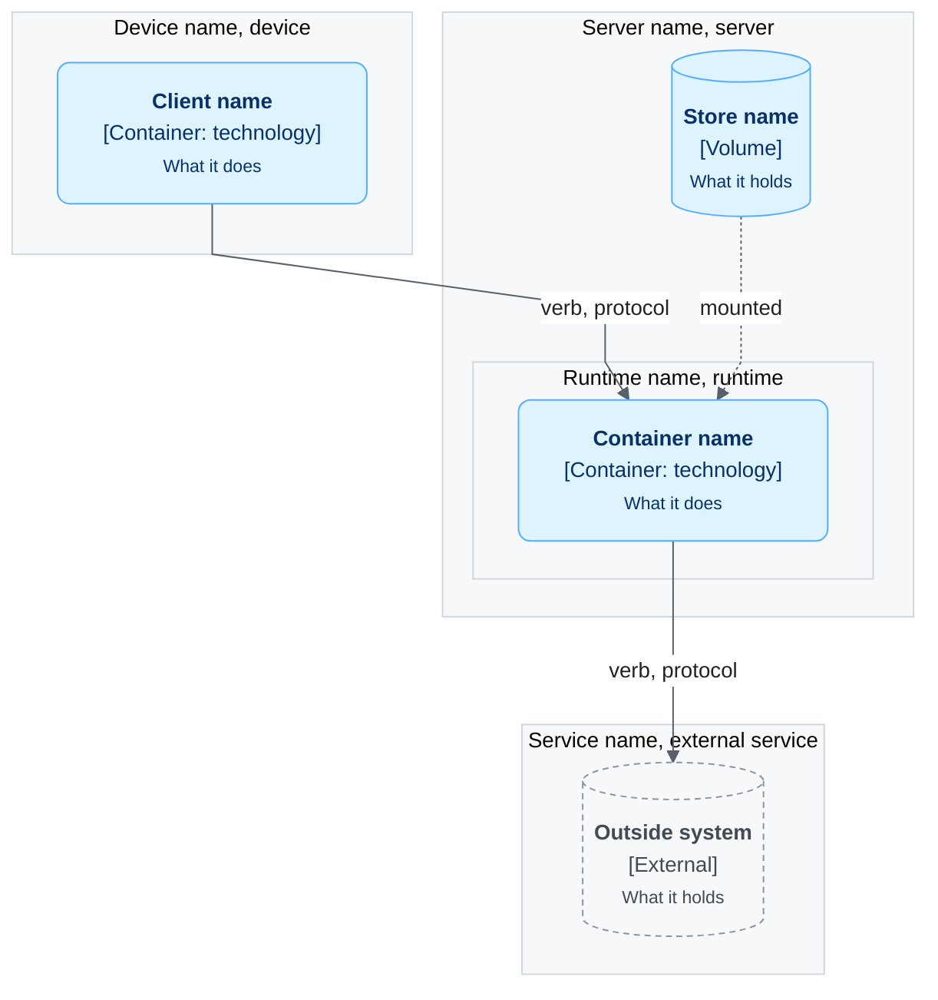
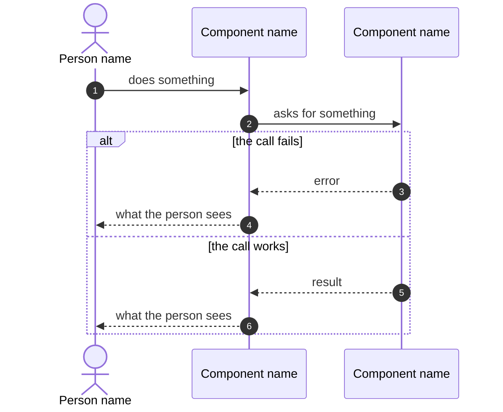

# Diagram templates

Every diagram in this repo starts from one of the five templates on this page. Copy the template,
keep the `%%{init}%%` line and the `classDef` lines as they are, and change only the nodes and
arrows.

## Rules for all diagrams

- One diagram answers one question. Write that question as the sentence above the diagram.
- A heading names the diagram type and its subject, such as "Level 2: containers".
- A table below the diagram lists each element and its job, unless the diagram has fewer than four
  elements.
- A diagram is a Mermaid block in a markdown file. No image files.
- C4 and deployment diagrams are Mermaid flowcharts that run top to bottom, `flowchart TB`.
- Use the same name for a thing in every diagram, in the text and in the code.

### Node labels

Each node has three lines. Mermaid wraps a long line, and a wrapped box is hard to read, so each
line has a limit.

| Line | Content | Format | Limit |
|---|---|---|---|
| 1 | The name | Bold, `<b>` | 25 characters |
| 2 | The kind and the technology, in brackets | Normal | 28 characters |
| 3 | What it does | Small, `<small>` | 28 characters |

```text
"<b>Name</b><br/>[Kind: technology]<br/><small>What it does</small>"
```

- Do not put a `<br/>` inside a line. If the text does not fit, cut it. The table below the
  diagram holds the full description.
- Leave out the technology when there is none, as in `[Person]`.
- Write `[External: technology]` for a system outside ours.
- A subgraph has one line: the name, a comma, then the kind, as in `Home server, server`.

### Shapes and classes

| Element | Shape | Class | Look |
|---|---|---|---|
| Person | Stadium `([ ])` | `person` | Dark blue, white text |
| This system, on level 1 | Rectangle `[ ]` | `system` | Blue, white text |
| Container | Rectangle `[ ]` | `container` | Pale blue, dark text |
| Component | Rectangle `[ ]` | `component` | Pale blue, dark text |
| Data store | Cylinder `[( )]` | `store` | Pale blue, dark text |
| System or person outside ours | Rectangle, stadium or cylinder | `external` | Grey, dashed outline |
| Server, device or boundary | Subgraph | none | Light grey box |

### Theme

The first line of each flowchart is the `%%{init}%%` block from the templates. It sets the font,
the line colour, straight lines, and the light grey background of a subgraph. Sequence diagrams
use Mermaid's default look and have no `init` line.

### Arrows

| Meaning | Arrow | Label |
|---|---|---|
| A call or a request | Solid `-->` | A verb, then the protocol if it matters: `"git pull, SSH"` |
| A file mount, or data that one part is built from | Dotted `-.->` | A verb |
| No access | Dotted with a cross `-.-x` | `"no route"` |

Each arrow has a label of at most 20 characters. The arrow points from the part that starts the
action.

## Template 1: C4 level 1, system context

Question it answers: who uses the system, and which outside systems does it depend on?



## Template 2: C4 level 2, containers

Question it answers: which parts that run or hold data make up the system, and how do they talk?



## Template 3: C4 level 3, components

Question it answers: which parts make up one container, and which part may call which?



## Template 4: deployment

Question it answers: on which machine does each container run, and what connects the machines?

A subgraph is a machine, a device or a service that runs things. Nest a subgraph for a runtime
inside its machine, such as Docker inside a server.



## Template 5: sequence

Question it answers: what happens, in order, when one thing occurs?

- The person or the system that starts the flow is the first participant, as an `actor`.
- The participants are containers or components from the C4 diagrams, with the same names.
- `autonumber` is on.
- A solid arrow `->>` is a call. A dashed arrow `-->>` is its answer.
- Each way the flow can fail is a branch of an `alt` block, with the failure first.


