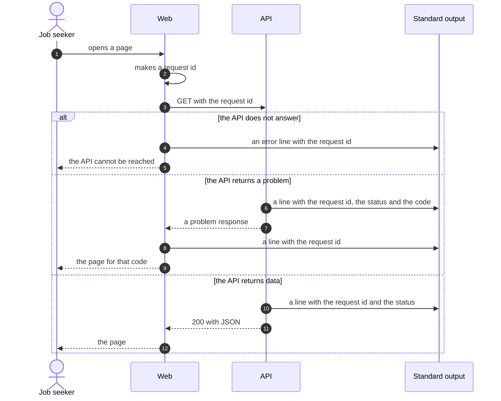

# Errors and logging

How a failure looks to the API, to the person and in the logs. See
[ADR-0012](../adr/0012-problem-details-and-json-logs.md).

## What counts as an error

| Case | API response | What the person sees |
|---|---|---|
| A note has a missing field or a bad value | `200`, the note with a `warnings` list | The note, with a warning that names the field |
| A link names a note or an achievement that does not exist | `200`, the link marked as missing | Text with a mark, not a link |
| No note has that slug | `404` problem, code `note_not_found` | A not-found page |
| An application has no resume | `404` problem, code `resume_not_found` | "No resume exists yet" |
| Refresh cannot pull the vault | `502` problem, code `vault_pull_failed` | A banner with the error and the old time |
| The API has no index yet | `503` problem, code `index_not_ready` | "The app is starting" |
| The API does not answer | none | "The API cannot be reached" |
| A bug in the API | `500` problem, code `internal_error` | An error page with the request id |

## The error shape

Every error response has the media type `application/problem+json`.

```json
{
  "type": "https://github.com/lyeyixian/job-search-app/blob/main/docs/architecture/errors-and-logging.md#note_not_found",
  "title": "Note not found",
  "status": 404,
  "detail": "No application has the slug example-company-backend-engineer.",
  "code": "note_not_found",
  "requestId": "01JCM8Z3"
}
```

- Web reads `code`. It never reads the text of `title` or `detail` to decide what to do.
- A new code gets a row in the table above in the same pull request.

## Sequence: a failed request

How does one failure show up in both services?



## Logs

Each service writes one JSON line per request to standard output.

```json
{"level":"info","time":"2026-11-14T08:47:10Z","service":"api","requestId":"01JCM8Z3","method":"GET","path":"/api/applications/example","status":404,"code":"note_not_found","ms":3}
```

- The API uses the `pino` library.
- Web sends the request id to the API in the `X-Request-Id` header.
- A log line never holds note content, frontmatter values or the text of a posting. A slug in a
  path is permitted.
- Refresh logs the commit, the count of notes and the count of warnings.
- Read the logs with `docker compose logs api` and `docker compose logs web`.
